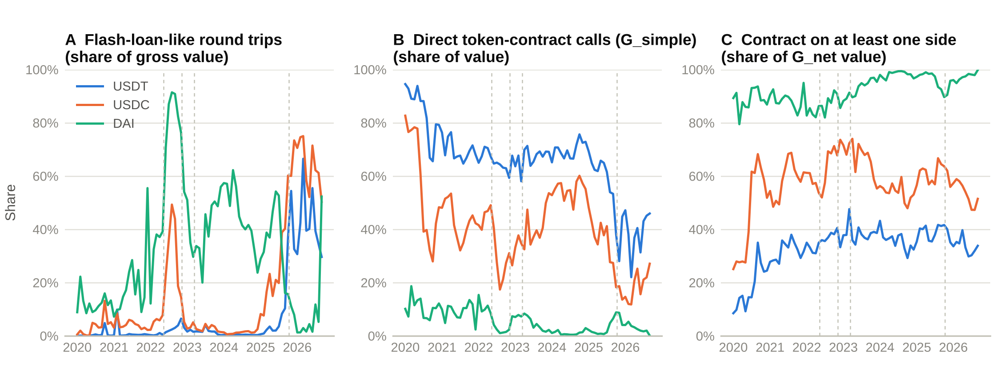
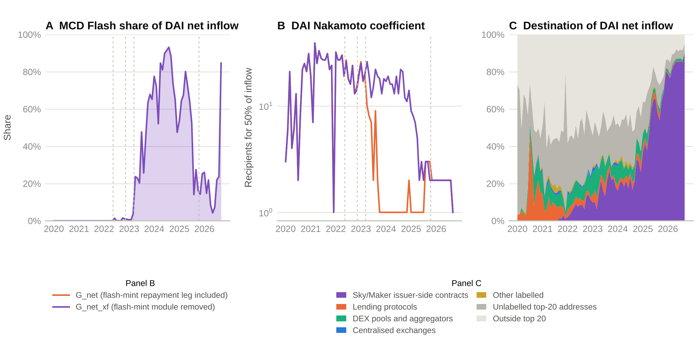
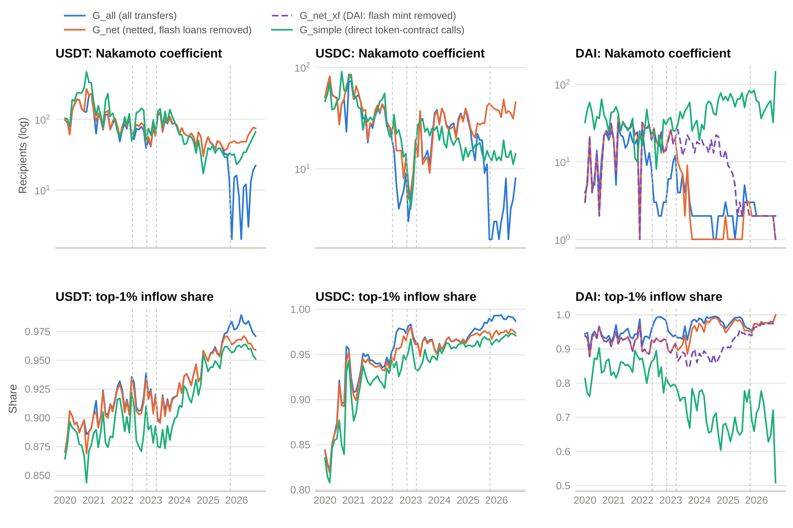
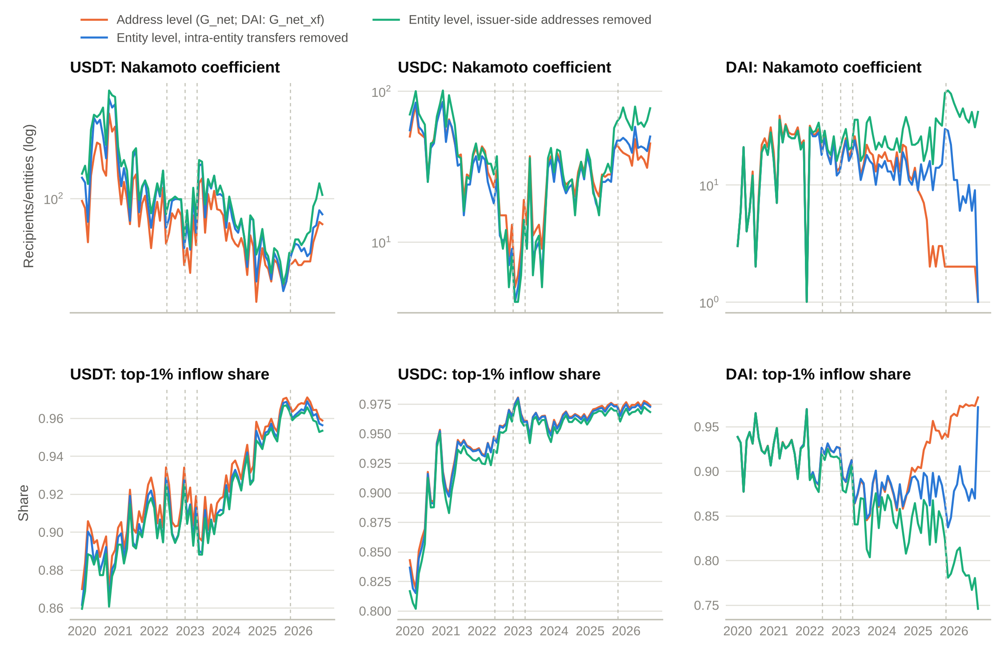
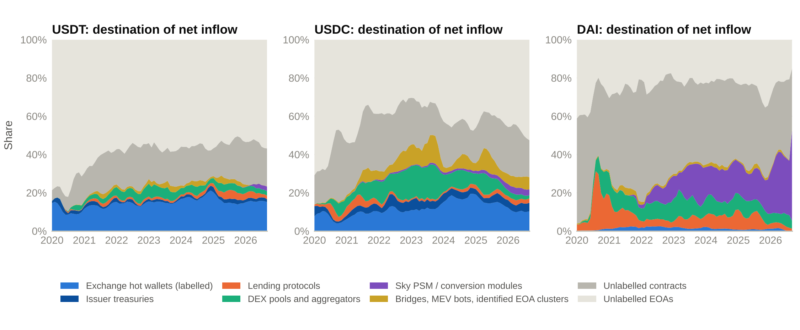
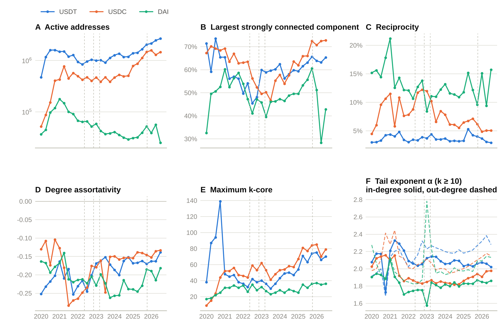
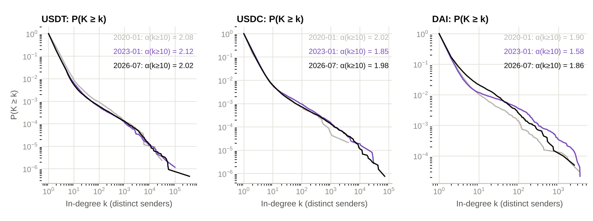
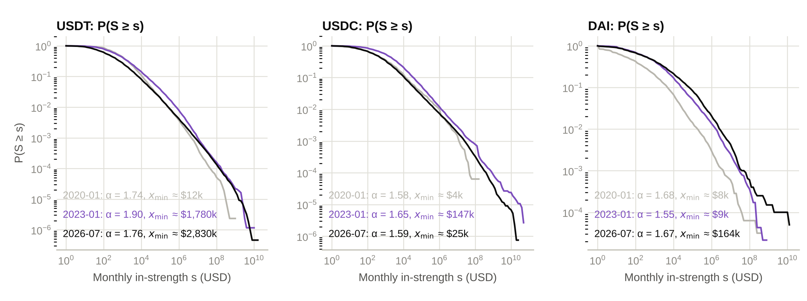
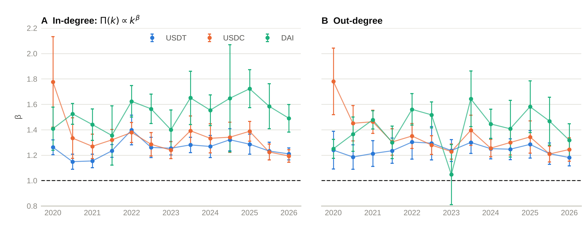

# Mapping the stablecoin transfer network on Ethereum after netting out flash loans, 2020–2026

Code, label table and processed indicator tables for the article *Mapping the stablecoin transfer network on Ethereum after netting out flash loans, 2020–2026: rising concentration in USDT, super-linear preferential attachment and the retreat of payment-like transfers* (Zhengdong Zhu, School of Business, Macau University of Science and Technology; submitted to PLOS ONE, October 2026).

Archived copy with a DOI: Zenodo, https://doi.org/10.5281/zenodo.23282476

## What the study does

81 monthly transfer networks for USDT, USDC and DAI on Ethereum, January 2020 to September 2026, built from 784 million transfers in the public Google BigQuery dataset `bigquery-public-data.crypto_ethereum`, under three network definitions:

- **G_all**: every transfer after removing mints and burns, self-transfers and transfers below 1 USD;
- **G_net**: intra-transaction netting at the level of the address pair, with flash-loan-like round trips (residual at most 0.1% of the gross flow) removed;
- **G_simple**: transfers made by transactions that call the token contract directly, the payment-like layer;
- **G_net_xf** (DAI only): G_net with the Sky MCD Flash module also removed.

Concentration of monthly inflow (Gini, top-0.1% and top-1% shares, Nakamoto coefficient, fixed-count shares), destination of inflow by labelled recipient (96 addresses, 32 entities), four stress episodes with placebo percentiles, topology of 27 quarterly snapshots (bow-tie, reciprocity, assortativity, k-core, degree and strength tails) and preferential attachment on 13 month pairs, unconditional and conditioned on address survival.

## Repository layout

| Folder | Contents |
|---|---|
| `sql/` | GoogleSQL for BigQuery: `pipeline_run_order.sql` (materialised tables and all monthly statistics, blocks 1–8), `dai_exclude_flashmint.sql`, `entity_level_queries.sql` (Q11–Q13), `top_receivers.sql`, `followup_queries_Q14_Q16.sql`, `followup_queries_Q17_Q18.sql`, `followup_queries_Q19.sql`, `first_look_concentration.sql` (provenance). Replace `YOUR_PROJECT` with your Google Cloud project ID and create a US-multi-region dataset named `stable`. |
| `python/` | `topology_snapshots.py` (quarterly snapshots, degree histograms, cached edge lists), `refit_tail_k10.py` (model comparison on the k ≥ 10 tails), `strength_fits.py`, `pa_fix.py` and `pa_survival.py` (preferential attachment, unconditional and survival-conditioned), `pa_synthetic_check.py`, `make_figures_en.py` (Figs 1–9), `verify_numbers.py` (recomputes every statistic quoted in the article), `q19_summary.py`; `offline_fits.py` and `degree_analysis.py` are kept for provenance. |
| `labels/labels_final.csv` | The 96-address label table: entity, entity group, category, confidence, source note. |
| `data/` | Every table the scripts read, in the layout they expect (see `data/README.md`). |
| `supporting_information/` | S1–S6 Table, S1 Text and S2 Text exactly as submitted. |
| `figures/` | PNG previews of Figs 1–9 (the submitted TIFFs are produced by `make_figures_en.py`). |

## Reproduce

```bash
pip install -r requirements.txt          # Python 3.12; pandas 3.0.6, numpy 2.5.3, scipy 1.18.1, python-igraph 1.0.0, powerlaw 2.0.0, matplotlib 3.11.2, google-cloud-bigquery 3.46.1
python python/verify_numbers.py          # prints every statistic of the article from data/
python python/make_figures_en.py         # writes figures/Fig1–Fig9 as PNG and 300-dpi RGB TIFF
python python/pa_synthetic_check.py      # synthetic validation of the preferential-attachment estimators
```

To regenerate `data/` from scratch, run the SQL in `sql/` in the BigQuery console in the order given in `pipeline_run_order.sql` and export each result to CSV with the file names given in the comments, then run `topology_snapshots.py`, `refit_tail_k10.py`, `strength_fits.py`, `pa_fix.py` and `pa_survival.py` (these stream the monthly edge lists from BigQuery, 1–3 GB per month, and need `GOOGLE_APPLICATION_CREDENTIALS` and a project with billing enabled; the whole pipeline costs on the order of 20 USD of BigQuery processing).

## Figures











## Licence

Code: MIT (see `LICENSE`). Label table and indicator tables: Creative Commons Attribution 4.0 International (CC BY 4.0). The underlying blockchain records are public.

## Citation

Zhu Z. Code, label table and indicator tables for: Mapping the stablecoin transfer network on Ethereum after netting out flash loans, 2020–2026. Zenodo; 2026. doi: 10.5281/zenodo.23282476 (see `CITATION.cff`).
